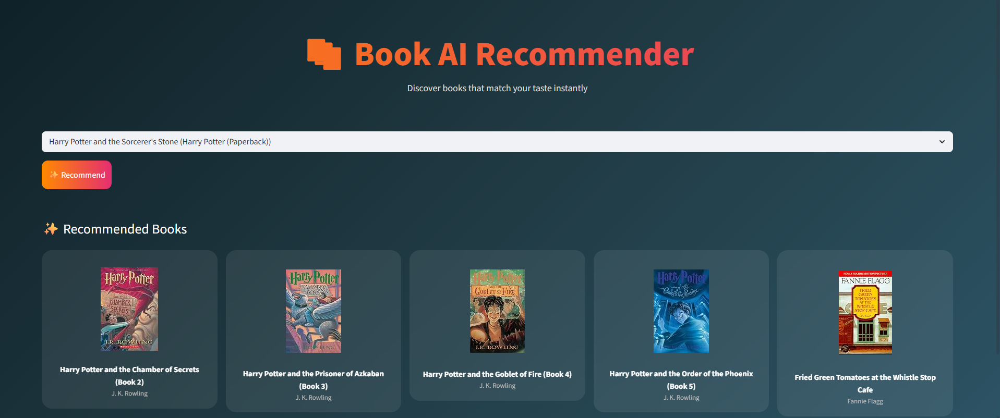

# Book AI – Book Recommendation System Using Machine Learning

Book AI is a **collaborative filtering-based book recommendation system** developed using Python, Machine Learning, Pandas, NumPy, Scikit-learn, and Streamlit.

The project analyses user-book rating interactions to identify books with similar rating patterns. It uses a user-item rating matrix and Cosine Similarity to recommend books.

The interactive Streamlit application allows users to select a book and discover five similar books, along with their authors and cover images.

## Application Preview



## Features

- **Collaborative Filtering:** Recommends books based on patterns in user ratings.
- **Data Preprocessing:** Handles missing values, invalid ages, publication years, and unrated interactions.
- **Active User Filtering:** Retains users who have rated at least 50 books.
- **Popular Book Filtering:** Retains books with at least 20 ratings.
- **User-Item Matrix:** Creates a pivot table of users and their book ratings.
- **Cosine Similarity:** Calculates similarity between books based on rating patterns.
- **Interactive Streamlit Interface:** Allows users to select a book and generate recommendations.
- **Book Cover Display:** Shows book cover images using image URLs provided in the dataset.

## Technologies Used

| Technology | Purpose |
|---|---|
| Python | Core programming language |
| Pandas | Dataset loading, cleaning, and manipulation |
| NumPy | Numerical operations and indexing |
| Scikit-learn | Cosine Similarity calculation |
| Pickle | Saving and loading model data |
| Streamlit | Interactive web application |

## Project Structure

```text
Book-Recommendation-System-Using-Machine-Learning/
│
├── app.py
├── train_model.ipynb
├── requirements.txt
├── .gitignore
├── README.md
└── app_preview.png
```

### Files Generated During Model Training

```text
books.pkl
pt.pkl
similarity.pkl
```

### Dataset Files Required Locally

```text
books.csv
ratings.csv
users.csv
```

The dataset and generated pickle files are not included in this GitHub repository. Users must download the datasets and generate the pickle files locally before running the application.

## Dataset

This project uses the **Book-Crossing Dataset**, which contains information about books, users, and book ratings.

Dataset source:

[Book Recommendation Dataset – Kaggle](https://www.kaggle.com/datasets/arashnic/book-recommendation-dataset)

The dataset consists of three files:

### 1. Books Dataset – `books.csv`

Contains book-related information:

- `ISBN` – Unique book identifier.
- `Book-Title` – Title of the book.
- `Book-Author` – Author of the book.
- `Year-Of-Publication` – Publication year.
- `Publisher` – Book publisher.
- `Image-URL-S` – Small book cover image.
- `Image-URL-M` – Medium book cover image.
- `Image-URL-L` – Large book cover image.

### 2. Users Dataset – `users.csv`

Contains user-related information:

- `User-ID` – Unique user identifier.
- `Location` – User location.
- `Age` – User age.

### 3. Ratings Dataset – `ratings.csv`

Contains user-book rating information:

- `User-ID` – Identifier of the user.
- `ISBN` – Identifier of the rated book.
- `Book-Rating` – Rating given by the user.

The dataset uses ratings from 1 to 10. A rating of 0 represents an implicit interaction rather than an explicit rating.

## How to Download the Dataset

1. Open the [Kaggle Book Recommendation Dataset](https://www.kaggle.com/datasets/arashnic/book-recommendation-dataset).
2. Sign in to your Kaggle account.
3. Download the dataset ZIP file.
4. Extract the downloaded files.
5. Locate the three CSV files containing books, users, and ratings.
6. Rename them if necessary to match these filenames:

```text
books.csv
users.csv
ratings.csv
```

7. Place all three CSV files in the root directory of the project, alongside `app.py` and `train_model.ipynb`.

**Important:** The filenames must match the names used in the notebook.

## How the Recommendation System Works

Book AI uses collaborative filtering to identify books with similar rating patterns across users.

### 1. Dataset Loading

The three datasets are loaded using Pandas:

- Books
- Users
- Ratings

The notebook explores the datasets using methods such as `head()`, `shape`, `info()`, `describe()`, `isnull().sum()`, and `duplicated().sum()`.

### 2. Data Cleaning and Preprocessing

**User Data:**
- Identifies unrealistic age values.
- Treats ages below or equal to 5 and ages greater than or equal to 100 as invalid.
- Replaces invalid and missing age values with the median age.

**Book Data:**
- Converts publication years into numeric values.
- Treats invalid years and years outside the range 1900–2025 as missing.
- Replaces missing publication years with the median publication year.
- Replaces missing publisher names with `Unknown`.

**Ratings Data:**
- Removes records with a rating of 0 because they do not represent explicit ratings.

**Identifier Standardization:**
- Converts ISBN values into strings.
- Removes unnecessary spaces.
- Converts ISBN values to uppercase.
- Converts user IDs into integer format.

### 3. Dataset Merging

The three datasets are combined using their common identifiers:

- Books and Ratings are merged using `ISBN`.
- The resulting dataset is merged with Users using `User-ID`.

This creates a combined dataset containing book details, user information, and rating interactions.

### 4. Active User Filtering

The model retains users who have rated at least 50 books.

This helps remove users with very few rating interactions and provides a more useful basis for collaborative filtering.

### 5. Popular Book Filtering

The model retains books that have received at least 20 ratings.

This reduces the number of less frequently rated books and focuses the recommendation model on books with sufficient rating information.

### 6. Creation of User-Item Matrix

A pivot table is created using:

- Rows: Book titles
- Columns: User IDs
- Values: Book ratings

Missing values are filled with 0.

The resulting matrix represents the rating patterns of users across different books.

### 7. Cosine Similarity Calculation

Scikit-learn's `cosine_similarity()` calculates similarity between the book rating vectors.

Books with more similar rating patterns receive higher similarity scores.

### 8. Saving the Model Files

The trained data is saved using Python's Pickle module.

| File | Purpose |
|---|---|
| `pt.pkl` | Stores the user-item pivot table, with book titles as rows and users as columns. |
| `similarity.pkl` | Stores the cosine similarity matrix between books. |
| `books.pkl` | Stores the processed book dataset used to retrieve book details and cover image URLs. |

These files allow the Streamlit application to load the trained data without repeating the complete training process.

## Recommendation Workflow

When a user selects a book:

1. The application identifies the selected book in the pivot table.
2. It finds the corresponding row in the similarity matrix.
3. It retrieves the similarity scores for that book.
4. It sorts the books in descending order of similarity.
5. It excludes the selected book itself.
6. It selects the top five similar books.
7. It retrieves their titles, authors, and cover image URLs from `books.pkl`.
8. Streamlit displays the recommendations in a five-column layout.

## Overall Project Architecture

```text
       Book-Crossing Dataset
          /      |      \
         /       |       \
      Books    Users   Ratings
         \       |       /
          \      |      /
           Data Preprocessing
                   |
                   v
             Dataset Merging
                   |
                   v
            Active User Filtering
              (50+ ratings)
                   |
                   v
             Popular Book Filtering
              (20+ ratings)
                   |
                   v
             User-Item Pivot Table
                   |
                   v
             Cosine Similarity
                   |
                   v
              Save Pickle Files
             /       |       \
            v        v        v
         books.pkl  pt.pkl  similarity.pkl
             \       |       /
              \      |      /
                Streamlit App
                    |
                    v
              Select a Book
                    |
                    v
           Similarity-Based Ranking
                    |
                    v
           Top 5 Book Recommendations
                    |
                    v
          Display Covers and Authors
```

## API Integration

This project does **not** require an external API or API key.

Book cover images are displayed using the image URLs already available in the `books.csv` dataset. These URLs are retained in `books.pkl` and used directly by the Streamlit application.

An internet connection may be required to load externally hosted book cover images.

## Installation and Setup

### 1. Clone the Repository

```bash
git clone https://github.com/YOUR-USERNAME/Book-Recommendation-System-Using-Machine-Learning.git
```

Navigate to the project directory:

```bash
cd Book-Recommendation-System-Using-Machine-Learning
```

### 2. Create a Virtual Environment

```bash
python -m venv myenv
```

Activate the environment on Windows:

```bash
myenv\Scripts\activate
```

### 3. Install Required Libraries

```bash
pip install -r requirements.txt
```

### 4. Download the Dataset

Download and extract the Book-Crossing Dataset from Kaggle.

Place these three files in the project root:

```text
books.csv
ratings.csv
users.csv
```

### 5. Generate the Model Files

Open `train_model.ipynb` using Jupyter Notebook or VS Code.

Run all notebook cells in the correct order.

The notebook will:

- Load the three CSV datasets.
- Explore and clean the data.
- Merge books, users, and ratings.
- Filter active users and popular books.
- Create the user-item pivot table.
- Calculate cosine similarity.
- Save the three pickle files.

After successful execution, verify that these files are present in the project root:

```text
books.pkl
pt.pkl
similarity.pkl
```

### 6. Run the Streamlit Application

Once all three pickle files have been generated, execute:

```bash
streamlit run app.py
```

The Book AI application will open in your web browser.

## Requirements

The project dependencies are listed in `requirements.txt`:

```text
streamlit
numpy
pandas
scikit-learn
```

## Important Notes

- Model training is required before launching the application for the first time.
- The Streamlit application loads the generated pickle files directly.
- The CSV datasets are not required every time the application runs, provided the pickle files already exist.
- The recommendation system is based on user rating patterns, not book descriptions or genres.
- Book cover images are retrieved using image URLs stored in the book dataset.
- No API key or API configuration is required.

## Future Enhancements

- Add user-specific personalized recommendations.
- Introduce a search feature for finding books.
- Add book descriptions, genres, and additional metadata.
- Improve the recommendation process using matrix factorization.
- Develop a hybrid recommendation system combining collaborative and content-based filtering.
- Add book ratings and reviews to the application.

## Acknowledgements

- [Kaggle](https://www.kaggle.com/) for hosting the Book Recommendation Dataset.
- [Scikit-learn](https://scikit-learn.org/) for Cosine Similarity.
- [Streamlit](https://streamlit.io/) for the interactive application framework.
- [Pandas](https://pandas.pydata.org/) and [NumPy](https://numpy.org/) for data processing and numerical operations.

---

**Book AI – Discover your next favourite read!**
